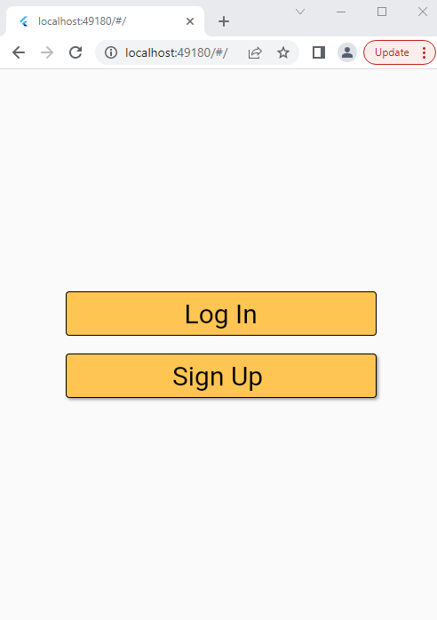
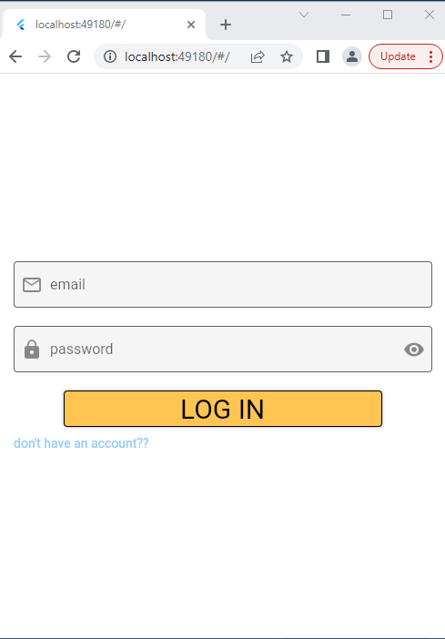
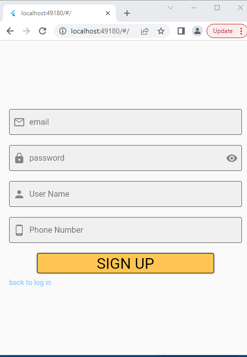

# Auth App — تطبيق المصادقة

User sign-up and login with Firebase Authentication, storing user profiles (name, email, phone) in Cloud Firestore and listing all registered users.

<div dir="rtl">

تطبيق لإنشاء حساب وتسجيل الدخول باستخدام Firebase Authentication، مع حفظ بيانات المستخدم (الاسم، البريد، الهاتف) في Cloud Firestore وعرض قائمة المستخدمين.

</div>

## Features

- Email & password sign-up / login (Firebase Auth)
- User profiles saved in Firestore (`users`)
- List of all registered users
- State management with Cubit (flutter_bloc)

## Screenshots

| Welcome | Log in | Sign up |
|:---:|:---:|:---:|
|  |  |  |

## Tech stack

Flutter, Firebase Auth, Cloud Firestore, flutter_bloc (Cubit), fluttertoast

## Project structure

```
lib/
├── cubit/
│   ├── auth_cubit.dart
│   └── auth_states.dart
├── firebase_options.dart
├── main.dart
├── models/
│   └── user_model.dart
└── screens/
    ├── first_screen.dart
    ├── home_screen.dart
    ├── login_screen.dart
    └── signup_screen.dart
```

## Getting started

```bash
git clone https://github.com/aesberali-boop/flutter-auth-app.git
cd flutter-auth-app
flutter pub get
flutter run -d chrome      # or: flutter run (Android / iOS)
```

The app uses Firebase. The web config lives in [`lib/firebase_options.dart`](lib/firebase_options.dart);
replace it with your own project's config if you fork this repo.


Only the Android, iOS and Web platforms are included. To add desktop support run
`flutter create --platforms=windows,macos,linux .`

## Documentation

- [`docs/report.docx`](docs/report.docx)

## License

[MIT](LICENSE)
